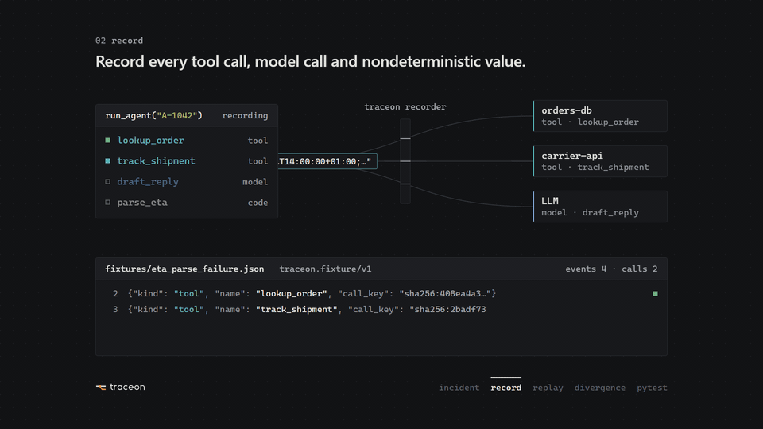
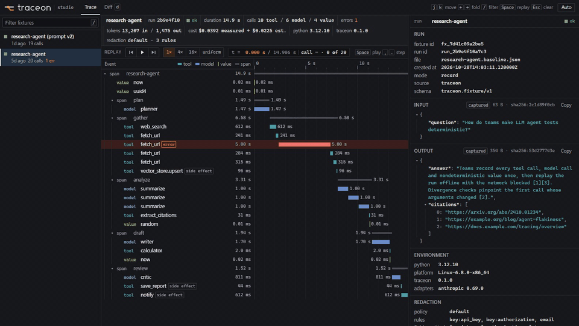
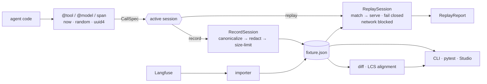

<div align="center">

<picture>
  <source media="(prefers-color-scheme: dark)" srcset="brand/logo-dark.svg">
  <source media="(prefers-color-scheme: light)" srcset="brand/logo.svg">
  
</picture>

**Record an AI agent run once. Replay it offline, deterministically, and see exactly where behavior changed.**

[](https://github.com/YourAnonELF/traceon-replay/actions/workflows/ci.yml)
[](pyproject.toml)
[](CHANGELOG.md)
[](LICENSE)



</div>

---

## What it does

An agent failed in production. The model answered differently, a tool returned
something unusual, the clock moved on -- and the run cannot be reproduced.
Traceon Replay records everything that made the run nondeterministic and lets
you run the same code against it again, as often as you like, without a
network connection, API keys or side effects.

| | |
|---|---|
| **Record** | `@tool` and `@model` decorators plus `now()`, `random()` and `uuid4()` capture every external call into a versioned JSON fixture. Secrets are redacted and model prompts are stored as a hash by default. |
| **Replay offline** | Re-run your agent code against the fixture. Tools and models are never executed, results come from the recording, and every socket connection is blocked. |
| **First divergence** | The first call whose kind, name or arguments differ from the recording is reported with its JSON path, expected and actual value: `tool:search $.limit: expected 3, got 5`. Replay fails closed: the changed call never reaches the real tool. |
| **Diff** | `traceon diff` aligns two runs call by call (LCS) and shows added, removed and changed calls, tokens, cost and errors, as text, JSON or Markdown for CI. |
| **pytest** | `@pytest.mark.traceon("fixtures/run.json")`, a `traceon_replay` fixture and record-once cassettes turn incidents into regression tests. Divergences appear in the test report and in the GitHub Actions job summary. |
| **Studio** | `traceon studio` opens a local web UI for runs and diffs. Binds to 127.0.0.1, no external requests. |
| **Langfuse import** | `traceon import langfuse --trace-id ...` converts a production trace into a fixture. |

It works with any agent framework, or none: instrumentation is two decorators
on the functions that touch the outside world.

## Demo

| Terminal: record, replay, divergence | Studio: run tree and diff |
|---|---|
|  |  |

The terminal demo is [`examples/failed_tool_call`](examples/failed_tool_call):
a parser bug is recorded in a failing run, reproduced offline, fixed and
verified against the same tool results, and a refactor that changes a tool
argument is caught as a divergence.

## Quick start

```bash
pip install "git+https://github.com/YourAnonELF/traceon-replay"   # Python 3.10+
```

**1 · Instrument the functions your agent uses to reach the outside world**

```python
# my_agent.py
from traceon import model, now, span, tool


@tool
def search(query: str, limit: int = 3) -> list[str]: ...  # real search API


@tool(side_effect=True)
def send_report(to: str, text: str) -> dict: ...  # real email; never executed in replay


@model(provider="openai")
def summarize(question: str, hits: list[str]) -> str: ...  # real LLM call


def run(question: str) -> dict:
    with span("research"):
        hits = search(question)
        summary = summarize(question, hits)
    send_report("team@example.com", summary)
    return {"summary": summary, "at": now().isoformat()}
```

**2 · Record a run**

```python
from traceon import record_run
from my_agent import run

with record_run(
    "research", fixture="fixtures/research.json", input={"question": "replay testing"}
) as handle:
    handle.set_output(run("replay testing"))
```

**3 · Replay it -- offline, no keys, no side effects**

```python
from traceon import replay_run

with replay_run("fixtures/research.json") as handle:
    handle.set_output(run("replay testing"))

print(handle.report.ok, handle.report.calls_served)  # True 4
```

Change `limit: int = 3` to `5` and replay again:

```text
x first divergence  argument_mismatch - call #0 - tool:search
    path      $.limit
    expected  3
    actual    5
```

**4 · Keep it as a regression test**

```python
import pytest
from my_agent import run


@pytest.mark.traceon("fixtures/research.json")
def test_research_agent():
    assert "replay testing" in run("replay testing")["summary"]
```

Runnable versions of all of this, with no network and no keys, are in
[`examples/`](examples): a [basic agent](examples/basic_agent), a
[failed run that is reproduced and fixed](examples/failed_tool_call), and a
[pytest regression suite](examples/regression_test). The full walk-through is
[docs/getting-started.md](docs/getting-started.md).

<details>
<summary>CLI commands</summary>

| Command | Purpose |
|---|---|
| `traceon record --entry mod:func --out run.json [--input JSON]` | Run an entry function and record it |
| `traceon replay run.json --entry mod:func [--by-key] [--override NAME=JSON] [--save out.json]` | Replay offline; exit 1 on divergence |
| `traceon diff base.json cand.json [--json\|--markdown] [--ignore PATH]` | Compare two runs; exit 1 if they differ |
| `traceon inspect run.json [--events] [--json]` | Span tree, timings, tokens, cost, errors |
| `traceon validate fixtures/*.json [--strict]` | Schema and limit checks |
| `traceon import langfuse --trace-id ID \| --file trace.json --out run.json` | Import a Langfuse trace |
| `traceon studio [paths...] [--port 7777]` | Local web UI |

Exit status: `0` ok, `1` divergence / regression, `2` usage or fixture error.
Details: [docs/cli.md](docs/cli.md).

</details>

## Why not just Langfuse or LangSmith?

Use them -- Traceon is not a replacement. Langfuse and LangSmith are
observability and evaluation platforms: they collect traces from running
systems, let you search, score and monitor them, and show you *that* a run went
wrong. They do not let you execute your code again against that exact run.

Traceon Replay is the piece after the trace: a local, file-based tool that
makes one run **reproducible**. It re-executes your agent with every external
call answered from the recording, blocks real side effects and the network,
and points to the first call where the new code behaves differently. Fixtures
live in your repository next to your tests; there is no backend and nothing is
sent anywhere.

The two fit together: find the failing trace in Langfuse, import it with
`traceon import langfuse`, fix the code, and keep the fixture as a regression
test in CI.

## Architecture



| Module | Role |
|---|---|
| `traceon.core` | Fixture schema (pydantic), canonical JSON and hashing, value comparison, safe I/O, limits, and the interception contract (`CallSpec`, `Session`) |
| `traceon.sdk` | `record_run`, `@tool`, `@model`, `span`, `now` / `random` / `uuid4`, capture and redaction policies |
| `traceon.replay` | `replay_run`, call matching (strict or by-key order), overrides, network guard, `ReplayReport` |
| `traceon.diff` | `compare`, metrics, text / Markdown renderers |
| `traceon.cli`, `traceon.pytest_plugin` | `traceon` command; marker, fixtures and CI summary |
| `traceon.studio` | Local read-only web UI (stdlib HTTP server, vanilla JS, strict CSP) |
| `traceon.integrations.langfuse` | Langfuse API client and trace importer |

The fixture format is documented field by field in
[docs/fixture-format.md](docs/fixture-format.md), with a JSON Schema in
[`schemas/fixture.schema.json`](schemas/fixture.schema.json). More in
[docs/architecture.md](docs/architecture.md) and
[docs/concepts.md](docs/concepts.md).

## Security and privacy defaults

- Local only: no backend, no telemetry.
- Model prompts are stored as a SHA-256 hash unless you opt in; stack traces are off.
- Every stored value passes a redaction policy: sensitive keys (`password`,
  `api_key`, `authorization`, `cookie` ...) and secret formats (OpenAI,
  Anthropic, AWS, GitHub, Slack, Stripe and Google keys, JWTs, bearer tokens,
  PEM private keys, Luhn-valid card numbers ...).
- Replay fails closed and blocks the network.
- Fixtures are treated as untrusted input: JSON only, size and depth limits,
  strict validation, nothing is ever deserialized into executable objects.

See [docs/security-and-privacy.md](docs/security-and-privacy.md).

## Limitations -- read before relying on a replay

- **Model internals are not reconstructed.** Replay returns the recorded
  response. It cannot tell you what a model would answer to a changed prompt;
  a changed prompt shows up as a divergence. Testing new prompts or models
  needs a new (live) recording.
- **Live reruns are nondeterministic.** Recording the same scenario twice calls
  real models and tools and will differ. Compare such runs with `traceon diff`
  and `--ignore` volatile fields.
- **Only instrumented boundaries are controlled.** Calls that bypass `@tool` /
  `@model`, and direct use of `datetime.now()`, `random` or `uuid`, are not
  recorded. Network blocking during replay exposes most of these, but it does
  not cover uvloop or C extensions that open sockets natively.
- **New code paths have nothing to replay.** If a change makes the agent call
  something that was never recorded, replay reports a divergence and stops.
  Use overrides for what-if runs, or re-record.
- **Concurrency** is supported with `order="by_key"` (FIFO per call name);
  concurrent calls of the same name that start in a different order will not
  match.
- **Redaction is pattern-based.** It removes common secret formats, not all
  personal data. Review fixtures before committing or sharing them.
- **Imported Langfuse traces** replay only when your call names and argument
  shapes match the observations; otherwise use them for inspection and diffing.
- Python only. 0.x: the Python API may still change; the fixture format is
  versioned (`traceon.fixture/v1`).

## Roadmap

- [ ] Live comparison mode: run against real tools and models while comparing with a recording
- [ ] LangChain / LangGraph adapter
- [ ] OpenAI Agents SDK adapter
- [ ] OpenTelemetry export (GenAI semantic conventions) and OTel trace import
- [ ] Streaming responses as first-class recordings

Details and priorities: [docs/roadmap.md](docs/roadmap.md).

## Development

```bash
git clone https://github.com/YourAnonELF/traceon-replay.git
cd traceon-replay
uv sync --extra dev
uv run pytest
uv run ruff check . && uv run mypy
```

See [CONTRIBUTING.md](CONTRIBUTING.md). Security issues: [SECURITY.md](SECURITY.md).

## Acknowledgements

- [vcrpy](https://github.com/kevin1024/vcrpy) (MIT) for the record/replay
  cassette idea that Traceon applies to agent tool and model calls.
- [Langfuse](https://langfuse.com) and
  [langfuse-python](https://github.com/langfuse/langfuse-python) (MIT) for the
  `@observe` decorator design and the trace / observation data model the
  importer reads.
- [OpenTelemetry](https://opentelemetry.io) (Apache-2.0) for the span and
  trace concepts Traceon's event tree follows.
- Built on [pydantic](https://docs.pydantic.dev), [click](https://click.palletsprojects.com)
  and [rich](https://github.com/Textualize/rich).

Traceon Replay is an independent project and is not affiliated with Langfuse,
LangChain / LangSmith or OpenAI.

## License

**Apache License 2.0** -- see [LICENSE](LICENSE) and [NOTICE](NOTICE).

---

<details>
<summary><b>Türkçe özet</b></summary>

Traceon Replay, bir yapay zekâ ajanının çalışmasını bir kez kaydeder ve aynı
çalışmayı **çevrimdışı, deterministik ve yan etkisiz** olarak tekrar oynatır.

- `@tool` ve `@model` dekoratörleri ile `now()`, `random()`, `uuid4()` her dış
  çağrıyı sürümlü bir JSON fixture dosyasına yazar. Gizli anahtarlar maskelenir,
  model istemleri varsayılan olarak yalnızca hash olarak saklanır.
- Tekrar oynatmada araçlar ve modeller çalıştırılmaz, sonuçlar kayıttan gelir,
  ağ bağlantıları engellenir.
- Davranışın ilk değiştiği çağrı JSON yolu, beklenen ve gerçek değerle
  raporlanır; değişen çağrı gerçek araca asla ulaşmaz (fail closed).
- `traceon diff` iki çalışmayı çağrı çağrı karşılaştırır; pytest eklentisi
  kayıtları regresyon testine dönüştürür; `traceon studio` yerel bir web
  arayüzü açar; Langfuse izleri içe aktarılabilir.

Hızlı başlangıç: `pip install "git+https://github.com/YourAnonELF/traceon-replay"` → fonksiyonları `@tool` / `@model`
ile işaretle → `record_run(...)` ile kaydet → `replay_run(...)` ile tekrar oynat.

Traceon, Langfuse veya LangSmith'in yerini almaz; onları tamamlar. Sınırlar:
model içi davranış yeniden üretilmez, canlı yeniden çalıştırmalar deterministik
değildir, yalnızca işaretlenmiş sınırlar kontrol edilir.
</details>
