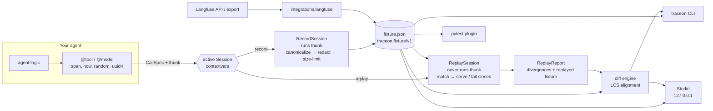

# Architecture

Traceon is a library, a CLI and a pytest plugin around one shared data model.
There is no server component; Studio is a local, read-only viewer.

## Modules

| Module | Responsibility |
|---|---|
| `traceon.core.schema` | Pydantic models: `Fixture`, `Event`, `Payload`, `Usage`, `Divergence`, `DiffReport` ... The single source of truth for the file format. |
| `traceon.core.canonical` | `canonicalize`, `canonical_json`, `content_hash`, `call_key`. Turns Python values into deterministic JSON data. |
| `traceon.core.compare` | `diff_values`, `first_difference`: structural comparison with JSONPaths, shared by replay and diff so messages are identical. |
| `traceon.core.io` | `load_fixture`, `parse_fixture`, `save_fixture` (atomic), `safe_join`. All bound checks for untrusted files. |
| `traceon.core.runtime` | The interception contract: `CallSpec`, abstract `Session`, `current_session()`, parent-span tracking. |
| `traceon.core.limits`, `traceon.core.errors` | Hard limits; exception hierarchy (`TraceonError` and subclasses). |
| `traceon.sdk` | `record_run`, `@tool`, `@model`, `span`, `now` / `random` / `uuid4`, `CapturePolicy`, `RedactionPolicy`, `RecordSession`, the payload pipeline. |
| `traceon.replay` | `replay_run`, `ReplaySession` (matching, overrides, strict / by-key order), `NetworkGuard`, `ReplayReport`. |
| `traceon.diff` | `compare` (LCS alignment over `(kind, name)`), `metrics`, text / rich / Markdown renderers. |
| `traceon.cli` | `traceon` command (click + rich). |
| `traceon.pytest_plugin` | Marker, `traceon_replay`, `traceon_cassette`, `assert_no_divergence`, job summary. |
| `traceon.integrations.langfuse` | `fetch_trace` (urllib, basic auth) and `import_trace` (Langfuse JSON → fixture). |
| `traceon.studio` | Stdlib `ThreadingHTTPServer` with a small JSON API and static vanilla JS/CSS. |

Dependency direction: `core` depends on nothing inside Traceon; `sdk`,
`replay`, `diff` and `integrations` depend on `core` (and `replay` /
`integrations` reuse the SDK's redaction policy); `cli`, `pytest_plugin` and
`studio` sit on top. Runtime dependencies are pydantic, click and rich.

## The interception contract

Instrumentation builds a `CallSpec` (kind, name, bound arguments, capture
options, `decode`, `usage` extractor) and calls
`current_session().call(spec, thunk)` (or `acall` for coroutines). With no
session the thunk runs directly. This keeps the decorators independent of
recording and replay, makes the overhead outside a session a single
context-variable lookup, and lets new adapters (framework integrations,
OpenTelemetry) plug in by producing `CallSpec`s.

The session and the current parent span live in `contextvars`, so each asyncio
task inherits the parent span that was active when it was created.

## Recording pipeline

For each payload: `canonicalize` → `RedactionPolicy.apply` → compute `sha256`
and size over the full redacted value → apply the capture mode
(`captured` / `hash_only` / `not_captured`) → truncate if larger than
`max_payload_bytes`. The `call_key` is computed from the redacted canonical
request regardless of the capture mode. Event sequence numbers are allocated
under a lock in start order; the fixture is written atomically on exit, also
when the agent raised.

## Replay

`ReplaySession` keeps a cursor (strict order) or per-`(kind, name)` FIFO
queues (by-key order) over `Fixture.calls()`. For each call it normalizes the
request with the same pipeline as the recorder, compares kind, name and
`call_key`, and either serves the recorded response (through `decode` if
given), serves an override, re-raises a recorded error, or records a
divergence and raises. `finish()` adds `missing_call`, `output_mismatch` and
`status_mismatch` divergences and builds the replayed fixture.

## Diff

`compare(baseline, candidate)` aligns the two call lists with a
longest-common-subsequence over `(kind, name)`, then compares requests,
responses and statuses of aligned pairs with `core.compare`, honoring
`ignore_paths`. Unaligned calls become `missing_call` / `unexpected_call`.
Metrics (calls, errors, tokens, measured and estimated cost, duration) are
computed per run.

## Design decisions

- **Fixtures are data.** No pickle, no executable tags, strict validation.
  This allows sharing fixtures in issues and committing them.
- **Fail closed.** An unmatched call raises instead of reaching the real world.
- **One comparison function.** Replay and diff produce identical paths and
  messages because both use `core.compare`.
- **Complement, not replace, observability.** Traceon does not collect traces
  from production; it imports them (Langfuse today, OpenTelemetry on the
  roadmap) and makes single runs reproducible.
